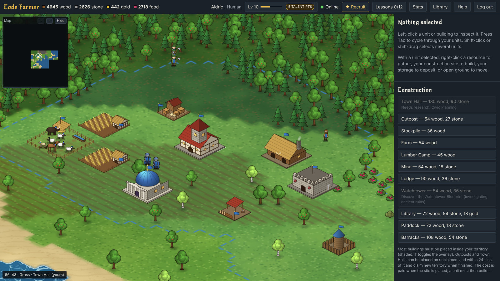
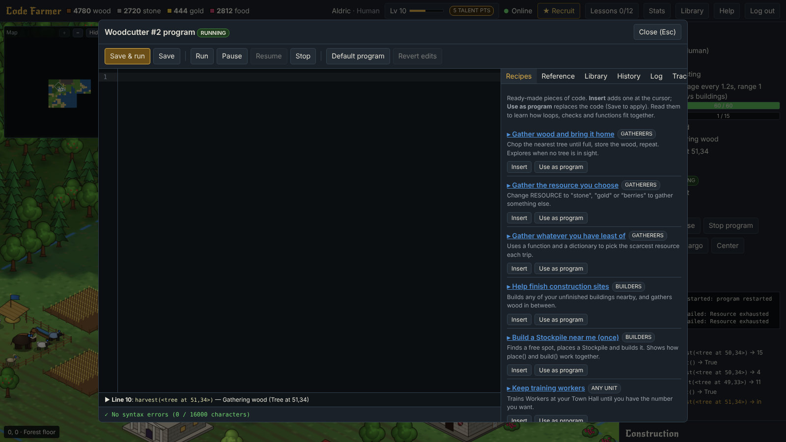
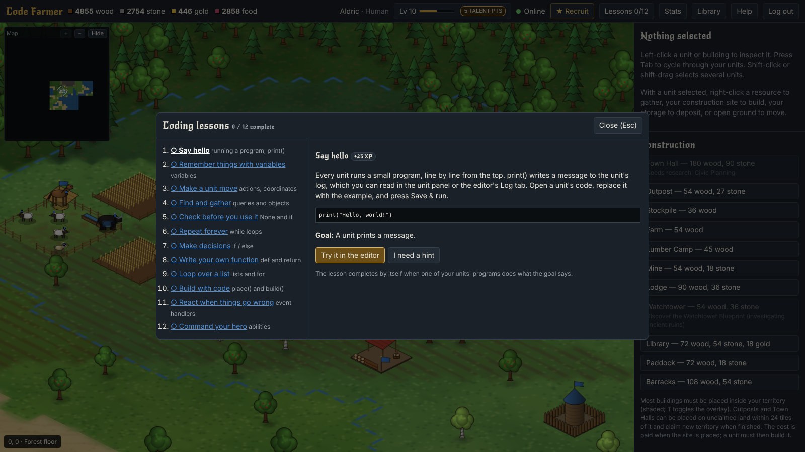
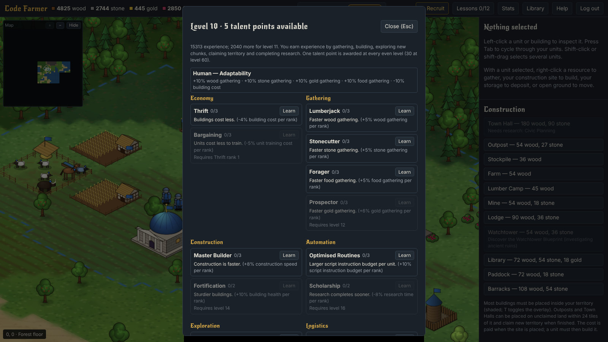
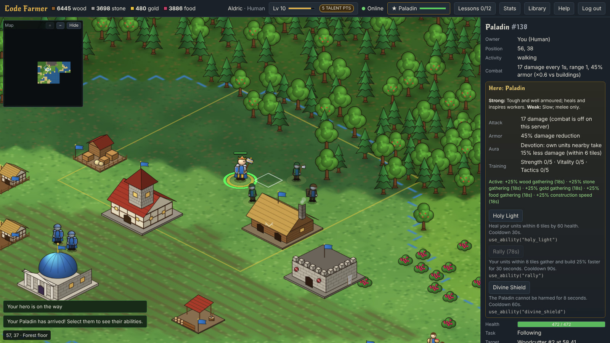
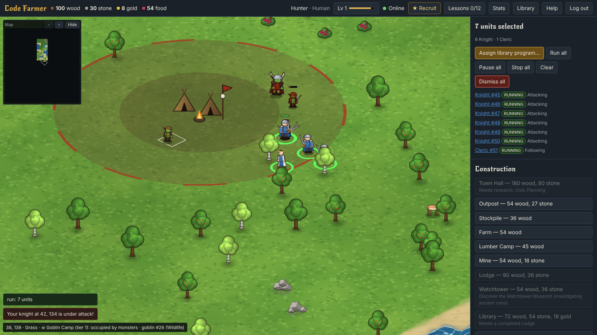
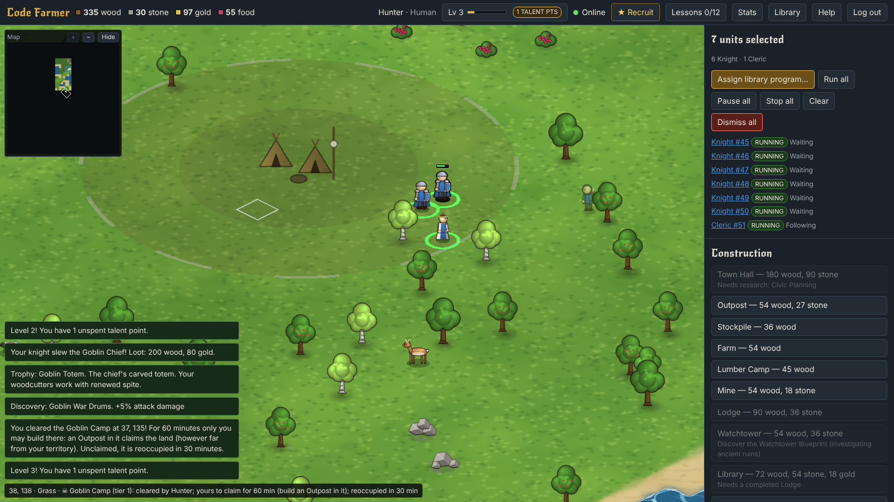
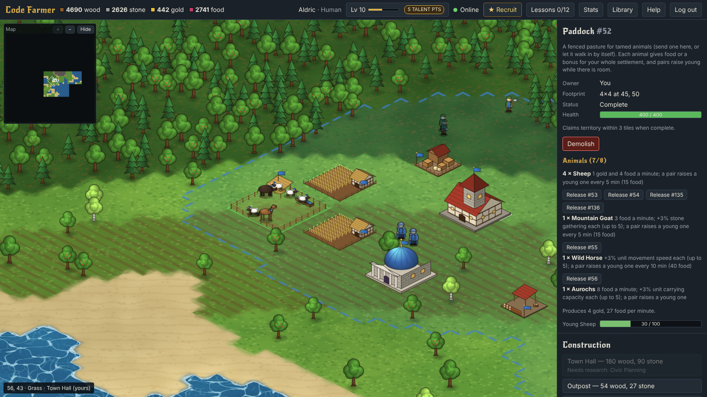
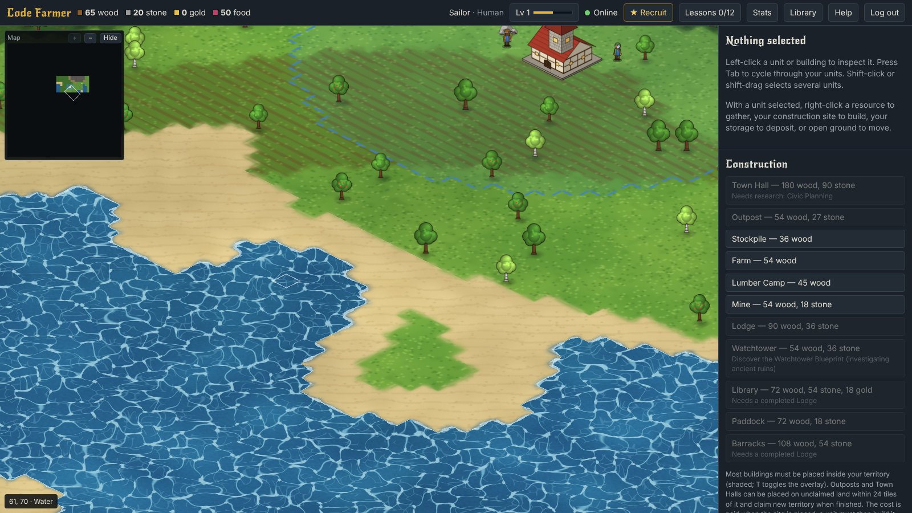
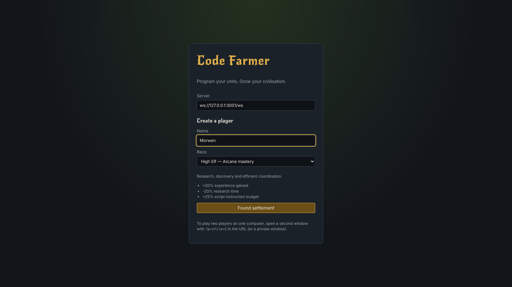

# Code Farmer

A multiplayer real-time strategy game where you grow a civilisation by **programming your units** in a Python-style language. You start with a Town Hall and three units in a procedurally generated, effectively infinite world, then write programs that gather, build, explore and fight for you, so your settlement keeps working while you plan the next one.



The server is authoritative (players cannot cheat by editing the client), the world is persistent (SQLite), and every unit runs real code in a sandboxed interpreter with instruction budgets. [IMPLEMENTATION_STATUS.md](IMPLEMENTATION_STATUS.md) lists exactly what works, how it was tested, and what is still missing.

## Contents

- [Features](#features)
- [Getting started](#getting-started)
- [How to play](#how-to-play)
- [Configuration](#configuration)
- [Production](#production)
- [Testing](#testing)
- [Project layout](#project-layout)
- [Troubleshooting](#troubleshooting)
- [Known limitations](#known-limitations)
- [Documentation](#documentation)
- [License](#license)

## Features

### Program your units

Every unit runs a program written in a restricted, Python-style language: variables, `if`/`elif`/`else`, `while` and `for` loops, functions, lists, dicts, `try`/`except` and event handlers. A Woodcutter's default program looks like this:

```python
# Default gatherer: harvest the nearest tree, return the wood, repeat.
resource = "tree"

while alive:
    if inventory.is_full():
        deposit()
    else:
        node = find_nearest(resource)
        if node is not None:
            harvest(node)
        elif not inventory.is_empty():
            deposit()
        else:
            print("No", resource, "nearby - exploring")
            explore()
```

Programs never touch the game state directly: they request actions, and the server validates each one. Loops and expensive code are bounded by per-tick instruction budgets, so a broken program cannot freeze the server.



The editor helps beginners:
- autocomplete, parameter hints and hover documentation;
- errors explained in plain language, with one-click fixes;
- warnings for common mistakes;
- a live "running line";
- version history;
- a shared code library;
- 12 tested recipes.

Twelve **guided lessons** teach the language. Each one is completed by the server when one of your saved programs actually does what the lesson asks.



### Build, expand and progress

- **Economy:** wood, stone, gold and food. Storage, finite and regrowing resources, and carrying capacity.
- **Buildings:** Town Halls, Outposts, Stockpiles, Farms, Lumber Camps, Mines, Lodges, Libraries, Watchtowers, Barracks and Paddocks.
  - Each is drawn in isometric pixel-art style, with construction stages and per-race palettes.
  - A building can be demolished. A construction site refunds half its cost; a finished building refunds nothing.
- **Territory:** buildings claim territory. Outposts and Town Halls expand it.
  - There's a territory overlay (press T), statistics and a leaderboard.
- **Research:** a Library research tree that unlocks commands and buildings and raises unit and building limits.
- **Races:** seven races (Human, Dark Elf, High Elf, Orc, Dwarf, Undead, Troll), each with passive bonuses.
- **Levels and talents:** levels 1–60 with a talent point at every even level, spent in data-driven talent trees.



### Heroes

Each race has its own hero (the Human hero is a Paladin). A hero has:
- an aura;
- three abilities with cooldowns, which you can use from the UI or from code with `use_ability(...)`;
- battle training at the Barracks;
- revival after death.



### Monster lairs (PvE)

Worlds generated with **generation v3** contain monster lairs: goblin camps, spider nests, bone crypts, ogre dens and drake roosts, each guarded by a pack and a boss. Monsters stay near their lair and attack intruders.

Clearing a lair with enough units gives:
- loot and experience;
- a permanent **boss trophy**;
- a code **discovery**;
- a 60-minute window in which only you may claim the land with an Outpost.

PvE works even when player-versus-player combat is switched off.




### Creatures and paddocks

- **Wild animals** can be observed, tamed (by bringing food) and trained to guard or follow.
- **Paddocks** hold up to eight tamed animals, drawn inside the fence. Each species gives one of the following:
  - passive production;
  - a settlement-wide bonus.
- Pairs of the same species **breed**.
- Animals can be released back to the wild.



### A living, infinite world

- The world is generated in chunks from a seed. It is deterministic and has no edges. It contains:
  - biomes and rivers;
  - forests, rocks and gold;
  - ruins to investigate;
  - wildlife that renews over time.
- Animated water draws moving caustics and a lapping shoreline in a single shader pass.
- A minimap shows what you have explored.
- **Combat is optional:** a server switch plus a per-player PvP opt-in, small contested zones where PvP is always on, stealthy Scouts, hunting and repairs.
- Optional per-building storage turns resources into goods that must be hauled between bases.



### Multiplayer

- One authoritative Node.js server runs the simulation; browsers only render it.
- Typed WebSocket messages are validated on the server.
- Interest management means each player receives only the chunks and entities they can see.
- Rate limits, and duplicate-request protection for economic actions.

## Getting started

### Prerequisites

- **Node.js 22.13 or newer** (the server uses the built-in `node:sqlite` module). Check with `node -v`.
- npm 10 or newer.
- A modern browser (Chrome, Edge or Firefox) with WebGL.

No native add-ons are compiled, so installation works the same on Windows, macOS and Linux.

### Install and run

```bash
npm install

# Terminal 1: the authoritative game server (ws://127.0.0.1:3001/ws)
npm run server

# Terminal 2: the browser client (http://127.0.0.1:5173)
npm run dev
```

Open http://127.0.0.1:5173, choose a name and race, and press **Found settlement**. The first start creates `data/codefarmer.db` and a new world from the seed in `config/server.json`. `npm run server:watch` restarts the server when code changes.



### Two or more players

Every browser profile remembers its own login. To play two players on one machine, open a second window at `http://127.0.0.1:5173/?profile=2` (any profile name works), or use a private window. Each profile creates its own player in the same shared world.

To connect from another machine:
1. Set `server.host` to `0.0.0.0` in the config.
2. Open port 3001.
3. Enter `ws://<server-ip>:3001/ws` in the **Server** field on the login screen, or set `VITE_SERVER_URL`.

## How to play

- **Programs:** your units start running their default programs straight away. The Woodcutter gathers wood, the Builder builds or quarries, and the Scout explores.
- **Mouse:** left-click to select; shift-click or shift-drag selects several units. With units selected, right-click to gather, build, deposit or move.
- **Keyboard:**
  - Tab cycles your units, Y selects your hero, Space centres the camera.
  - WASD pans and the mouse wheel zooms.
  - T toggles the territory overlay, F3 shows the performance overlay, and Help lists everything.
- **Edit code:** opens a unit's program. **Save & run** stores a new version and restarts it; the History tab restores old versions.
- **Settlement:** build a **Stockpile** near resources, a **Farm** for food, and train **Workers** at the Town Hall. Buildings must go inside your territory; an **Outpost** extends it.
- **Research:** build a **Lodge**, then a **Library**. Gathering, building and exploring earn experience; spend talent points with the level button.
- **Discovery:** right-click a **ruin** to investigate it, or an **animal** to observe it, then tame it by carrying food. Discoveries unlock commands and buildings.
- **Removing things:**
  - **Dismiss** removes your own units; heroes can't be dismissed, and tamed animals go back to the wild.
  - **Demolish** removes buildings.
  - Both ask for a second click to confirm.

The language is documented in [docs/SCRIPTING.md](docs/SCRIPTING.md) and in the editor's Reference tab.

## Configuration

Server settings live in `config/server.json`. All keys are optional, and defaults apply. Environment variables, or a `.env` file (copy `.env.example`), can override the port, host, database path and admin token. Every option, with its default and limits, is in [docs/CONFIGURATION.md](docs/CONFIGURATION.md).

**World settings (`seed`, `generationVersion`, `chunkSize`, `resourceDensity`) are fixed when a world is created.** If they later differ from the stored world, the server refuses to start rather than silently regenerate the terrain.

- **Monster lairs need generation v3.** The shipped config uses v2 (ruins and wildlife).
  - For a **new** world with lairs, set `"generationVersion": 3` before the first start.
  - To add lairs to an **existing** world, set it to 3 and run `npm run world:upgrade -- --confirm`. This backs up the database first, keeps every existing tile, resource, ruin and animal unchanged, and adds the lairs and the new species. Each run upgrades one version (v1 to v2, then v2 to v3).
- **To start a new world on purpose:** `npm run world:reset -- --confirm` archives the old database to `data/*.bak`; nothing is deleted.
- **Combat** is off unless `"combat": {"enabled": true}` is set. PvE against monsters is controlled separately by `combat.pve` and is on by default.

## Production

```bash
npm run build      # typecheck + client bundle into dist/
npm start          # game server
```

Serve `dist/` with any static web server. Copy `config/server.production.example.json` to `config/server.json`, then set `allowedOrigins`, a new seed, and the admin token (`CODEFARMER_ADMIN_TOKEN`, in the environment rather than the file). Deployment, backups and restores are covered in [docs/OPERATIONS.md](docs/OPERATIONS.md).

Database commands:
- `npm run db:migrate` applies pending migrations (the server also does this on start).
- `npm run world:info` prints the stored world's seed, generation version and entity counts.
- Backups: stop the server and copy `data/codefarmer.db*`.

## Testing

```bash
npm test            # 157 automated tests (node:test)
npm run typecheck   # strict TypeScript across server, simulation and client
npm run lint        # ESLint
npm run smoke       # a headless bot plays the core loop against a running server (start npm run server first)
```

The tests cover:
- world generation determinism;
- the economy and its exactly-once charging;
- scripting limits and sandboxing;
- multiplayer isolation and hidden information;
- persistence across restarts;
- progression, PvE, paddocks, removal and more.

The browser checks behind the screenshots, and the manual smoke-test checklist, are in [docs/TESTING.md](docs/TESTING.md).

## Project layout

```
src/
  sim/       authoritative simulation (world, units, buildings, territory, combat, PvE)
  script/    the Python-style language: lexer, parser, compiler, VM, editor assistance
  server/    WebSocket server, config, persistence (SQLite + migrations), admin tools
  shared/    definitions shared by server and client (units, buildings, races, talents, protocol)
  client/    React UI and the PixiJS renderer (isometric art, terrain painter, water shader)
tests/       automated tests (node:test)
tools/       the smoke-test bot
config/      server configuration and a production template
docs/        architecture, design, scripting, configuration, operations, testing, decisions
```

## Troubleshooting

| Symptom | Fix |
| --- | --- |
| `No such built-in module: node:sqlite` | Upgrade Node.js to 22.13 or newer. |
| `ExperimentalWarning: SQLite is an experimental feature` | Expected on Node 22; harmless. |
| Server exits with "generation settings differ from the config" | The config's world settings changed after the world was created. Restore them, point `persistence.databasePath` at a new file, or run `npm run world:reset -- --confirm`. |
| Server exits saying the world "uses generation v2 but the config asks for v3" | Run `npm run world:upgrade -- --confirm` (it backs up the database first), or set `generationVersion` back to 2. |
| Login screen says it could not connect | Start the server (`npm run server`) and check the Server field. |
| "That name is already registered" | Names are unique. Use "Continue as …" in the browser that created it, or pick another name. |
| A second browser tab logs out the first | Both tabs use the same profile. Add `?profile=2` to one of them. |
| The water looks still | The animated-water shader could not run on this graphics driver (the reason is logged in the browser console); the painted water is shown instead. |
| Port 3001 in use | Set `CODEFARMER_PORT` (and update the client's Server field). |

## Known limitations

- Running programs are not saved mid-execution: after a server restart they start again from the top.
- Persistence flushes every 2 seconds (configurable). A hard crash can lose up to that much progress, but never leaves a partial transaction.
- Accounts are a name plus a random token stored in the browser. This is development-grade authentication, with no passwords or recovery.
- Balance hasn't been play-tested: monsters, lair rewards, paddock output, combat and storage networks are first estimates.
- Pathfinding: in rare dense-forest pockets a unit may not find a long route and reports "No route found".
- The intended scale is one server process with SQLite; [docs/DECISIONS.md](docs/DECISIONS.md) describes the migration path.

## Documentation

- [IMPLEMENTATION_STATUS.md](IMPLEMENTATION_STATUS.md): feature-by-feature status and test evidence
- [docs/ARCHITECTURE.md](docs/ARCHITECTURE.md): modules, simulation, network protocol, persistence, rendering, security
- [docs/GAME_DESIGN.md](docs/GAME_DESIGN.md): rules and balance
- [docs/SCRIPTING.md](docs/SCRIPTING.md): the language and its grammar
- [docs/CONFIGURATION.md](docs/CONFIGURATION.md) and [docs/OPERATIONS.md](docs/OPERATIONS.md): settings, deployment, backups
- [docs/TESTING.md](docs/TESTING.md): automated tests, browser checks, manual checklist
- [docs/ROADMAP.md](docs/ROADMAP.md) and [docs/DECISIONS.md](docs/DECISIONS.md): what's next and why things are the way they are

## License

Copyright (C) 2026 ripcrispy

Code Farmer is free software: you can redistribute it and/or modify it under the terms of the GNU General Public License as published by the Free Software Foundation, either version 3 of the License, or (at your option) any later version. It is distributed in the hope that it will be useful, but WITHOUT ANY WARRANTY; without even the implied warranty of MERCHANTABILITY or FITNESS FOR A PARTICULAR PURPOSE. See [LICENSE](LICENSE) for the full text.

The New Rocker font used for headings is a separate work under the SIL Open Font License 1.1, installed from npm (`@fontsource/new-rocker`) rather than stored in this repository.
